# depressedyoungmanblog

[English](README.md) · Français

> La version de référence est l'anglaise ([README.md](README.md)) ; ce fichier en est la traduction.

Un petit blog personnel auto-hébergé qui fait tout pour ne pas savoir qui sont
ses lecteurs. C'est une application Flask + SQLite avec des articles, des
commentaires imbriqués, un chat privé entre chaque lecteur et le propriétaire
du site, et un panneau d'administration ; elle fonctionne entièrement sans
JavaScript et sans rien charger depuis un tiers. Elle est pensée pour être
servie en service onion Tor, mais tourne aussi bien derrière un reverse proxy
HTTPS classique.

> **Vibe coded.** Ce projet a été développé avec une forte assistance d'outils
> d'IA. Il a été relu et il est couvert par des tests de sécurité, mais lisez le
> code avant de lui confier quoi que ce soit de sensible, et signalez toute anomalie.

> **Mises à jour de sécurité :** les dépendances sont épinglées au-delà de leurs
> CVE connues. Mettez à jour avec `./update.sh`, ou activez les mises à jour
> automatiques (`./auto-update.sh enable weekly`). Historique dans
> [SECURITY.fr.md](SECURITY.fr.md).

## Sommaire

- [Modèle de confidentialité](#modèle-de-confidentialité)
- [Captures d'écran](#captures-décran)
- [Fonctionnalités](#fonctionnalités)
- [Démarrage rapide](#démarrage-rapide)
- [Configuration](#configuration)
- [Déploiement](#déploiement)
- [Mises à jour et sauvegardes](#mises-à-jour-et-sauvegardes)
- [API mobile d'administration](#api-mobile-dadministration)
- [Notes de sécurité](#notes-de-sécurité)
- [Tests et CI](#tests-et-ci)
- [Organisation du projet](#organisation-du-projet)
- [Licence](#licence)

## Modèle de confidentialité

**Pour qui.** Un propriétaire unique qui écrit, et des lecteurs qui peuvent
vouloir rester anonymes, y compris vis-à-vis de l'hébergeur et des sites vers
lesquels le blog pointe.

### Ce qui est protégé

- **Aucun JavaScript.** Chaque page est du HTML et du CSS simples. La
  Content Security Policy impose `script-src 'none'` et `style-src 'self'` :
  le site fonctionne dans Tor Browser au niveau « Le plus sûr » et un script
  injecté ne s'exécuterait pas.
- **Aucune requête vers des tiers.** Pas de CDN, pas de police web (polices du
  système), pas de statistiques, pas de widget intégré. Les images externes
  des articles et commentaires sont affichées en lien et jamais chargées
  (`img-src 'self' data:`). Les liens sortants portent `rel="noreferrer"` et le
  site envoie `Referrer-Policy: no-referrer`. La page de dons renvoie vers un
  service d'échange externe ; il est signalé comme tiers et n'est contacté que
  si le lecteur clique.
- **Pas d'adresse IP dans les journaux par défaut.** Un filtre remplace les
  adresses des clients par `[ip]` dans les journaux de Werkzeug et de
  l'application (la boucle locale est conservée). `LOG_CLIENT_IP=true` le
  désactive pour le débogage.
- **Le rate limiter ne stocke ni adresse ni pseudo.** Son fichier d'état SQLite
  ne contient que des empreintes HMAC-SHA256 de ses clés, dérivées de
  `SECRET_KEY`.
- **Chiffrement au repos** (Fernet, clé dérivée par PBKDF2-SHA256 de
  `ENCRYPTION_KEY` + `ENCRYPTION_SALT`) pour : les messages du chat, tous les
  fichiers envoyés (pièces jointes et photos de profil, stockés en `.enc` sous
  des noms aléatoires) et les secrets TOTP.
- **Métadonnées des images supprimées.** Les images envoyées sont réencodées en
  WebP (côté le plus long limité à 1600 px), ce qui retire EXIF, GPS, XMP et
  autres blocs.
- **Un compte ne demande qu'un pseudo et un mot de passe.** Aucune adresse
  e-mail n'est demandée à l'inscription.
- **Authentification solide.** Mots de passe hachés avec bcrypt ; 2FA TOTP
  optionnelle par compte avec 10 codes de secours à usage unique (seul leur
  SHA-256 est stocké) ; un code TOTP ne peut pas être rejoué.
- **Limites contre la force brute.** Les échecs de connexion sont comptés par
  pseudo (10 par 15 min) et par client (5 par 5 min) ; les codes 2FA sont
  limités à 5 essais par 5 min et par compte ; formulaires, commentaires, chat,
  recherche et envois de fichiers sont limités. Une connexion échouée coûte
  toujours une vérification bcrypt : le temps de réponse ne révèle pas quels
  pseudos existent.
- **Contrôle des sessions.** Changer de mot de passe, changer de rôle ou
  utiliser « se déconnecter partout » invalide toutes les autres sessions et
  les cookies « se souvenir de moi ». Les cookies de session sont `HttpOnly`,
  `SameSite=Strict`, `Secure` par défaut et nommés `__Host-sid` (session de 4
  heures, « se souvenir de moi » 7 jours).
- **Le lecteur garde la main sur ses données.** Depuis `/account/security`, il
  peut télécharger un export JSON de ses données ou supprimer son compte
  (messages, pièces jointes, likes et notifications effacés, commentaires
  anonymisés).

### Ce qui n'est pas protégé

- **Le chiffrement est au repos, pas de bout en bout.** La clé est sur le
  serveur, à côté de la base. Elle protège une copie volée du seul fichier de
  base ; elle ne protège ni contre quelqu'un qui contrôle le serveur en
  fonctionnement, ni contre une réquisition adressée à son exploitant. Dites
  « chiffré au repos » à vos lecteurs.
- **Tout n'est pas chiffré.** Articles, commentaires, pseudos, profils et
  messages du formulaire de contact (nom, e-mail, texte) sont stockés en clair
  dans la base.
- **Les pièces jointes non-image ne sont pas nettoyées.** PDF, documents
  bureautiques, archives et médias sont chiffrés au repos mais gardent leurs
  propres métadonnées.
- **La machine hôte.** L'application ne chiffre ni le disque ni le swap ; voir
  [deploy/README.md](deploy/README.md) pour ce que couvre ou non le
  déploiement onion.
- **L'installation du lecteur.** Un lecteur qui n'utilise pas Tor reste visible
  de son réseau et du reverse proxy du serveur.

[docs/ANONYMAT.md](docs/ANONYMAT.md) est l'audit détaillé de confidentialité :
ce qui a été trouvé, corrigé, et ce qui reste ouvert.

## Captures d'écran

Pages réelles de l'application en fonctionnement, capturées sur une base
jetable remplie de fausses données de démonstration (aucun vrai utilisateur ni
article).

### Site public

**Page d'accueil : introduction et derniers articles**

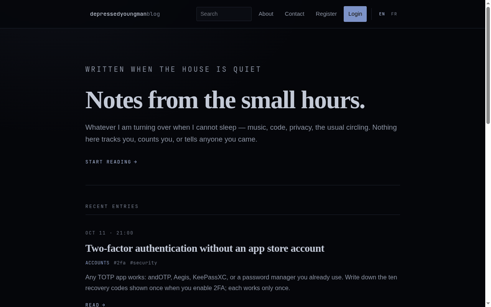

**Article avec catégorie, tags, likes et commentaires imbriqués**

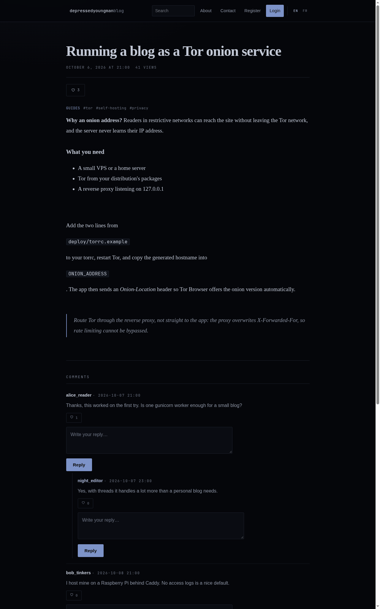

**Page « À propos » (texte par défaut)**

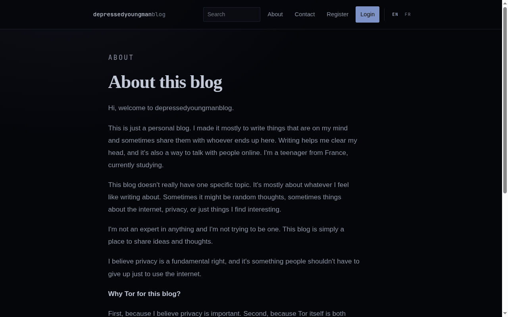

**Page de dons : liste des soutiens (vide ici) et instructions d'échange anonyme**

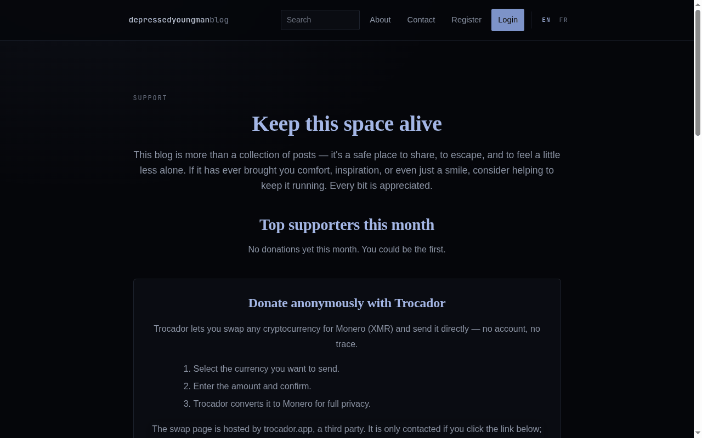

**Page d'accueil sur téléphone (390 px de large)**

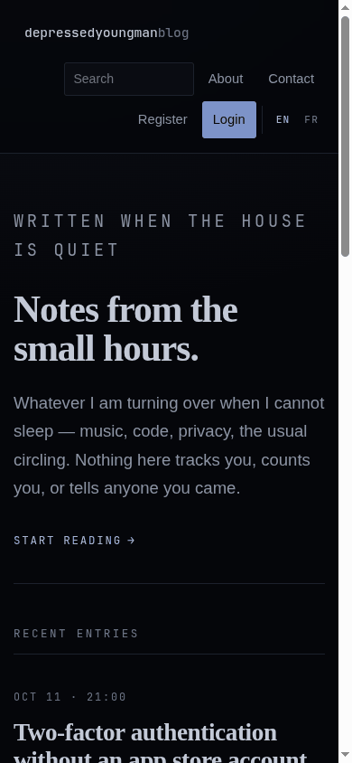

### Comptes et sécurité

**Formulaire de connexion**

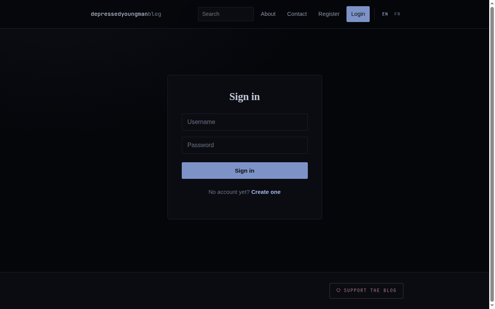

**Création de compte : pseudo et mot de passe uniquement**

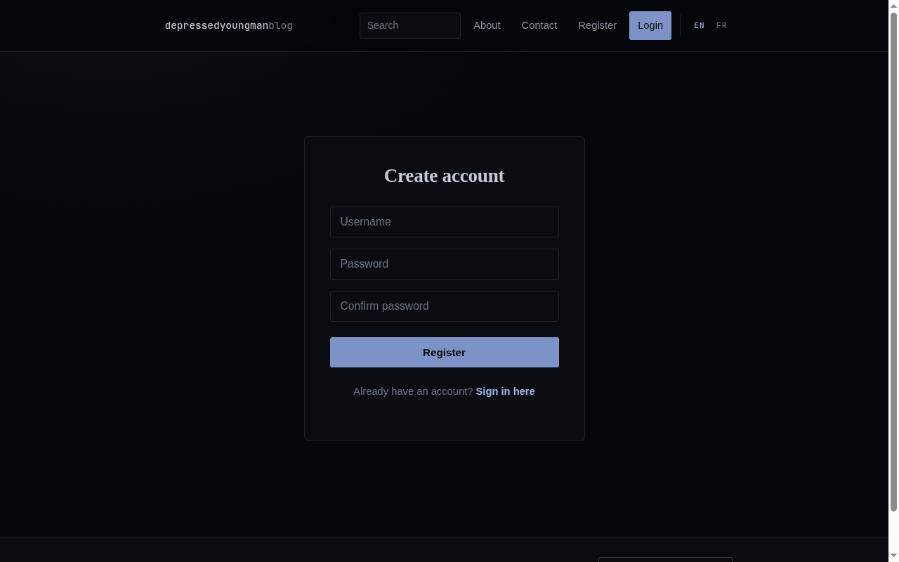

**Page sécurité du compte (haut) : changement de mot de passe, état de la 2FA et codes de secours**

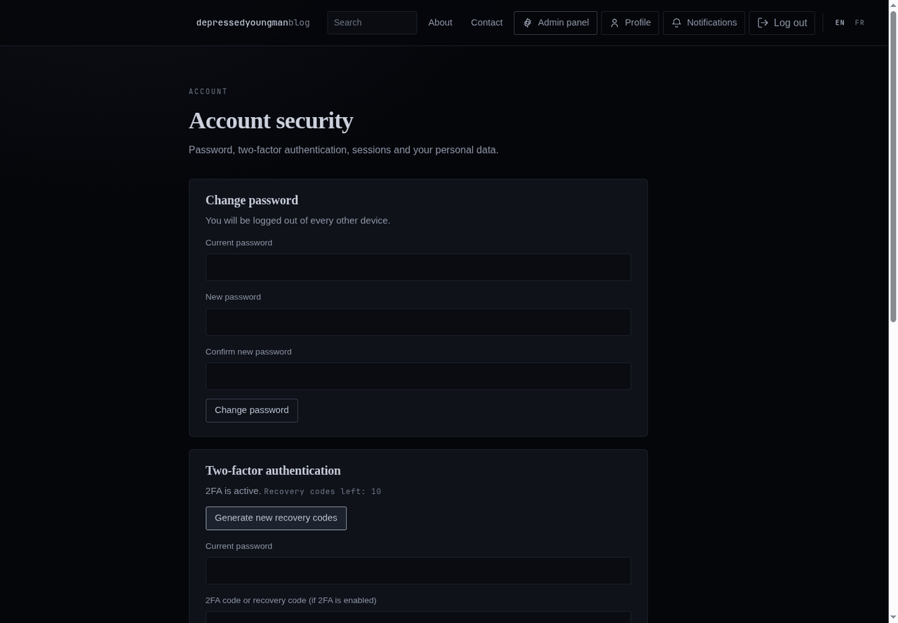

**Codes de secours 2FA à usage unique, affichés une seule fois (valeurs de démonstration)**

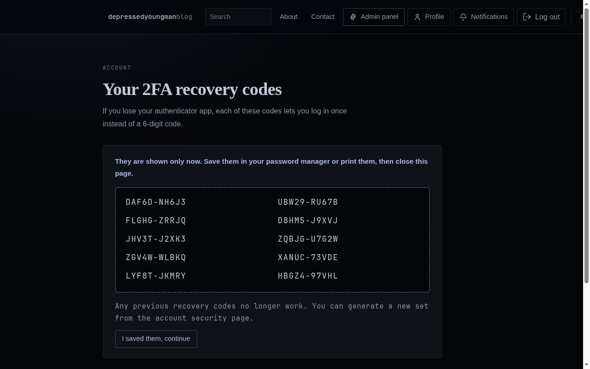

### Administration

**Vue d'ensemble admin : ce qui attend, raccourcis, chiffres du site**

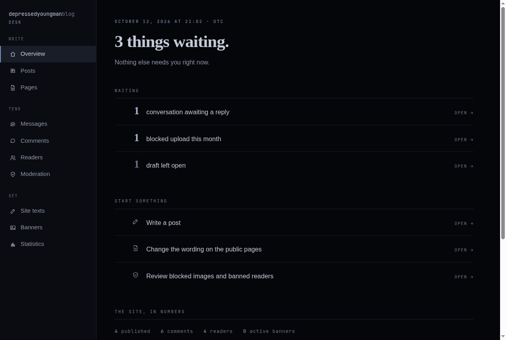

**Côté admin du chat chiffré : liste des lecteurs et conversation**

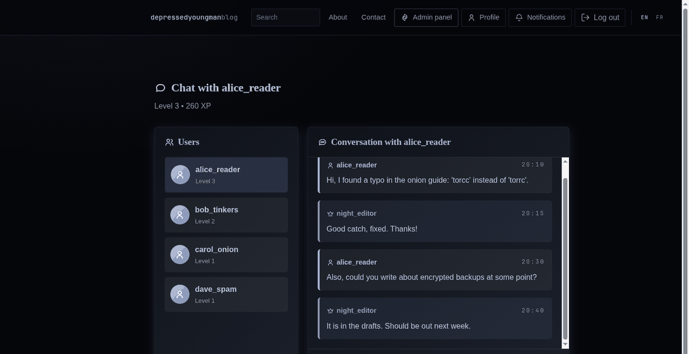

**Éditeur des textes du site : chaque texte fixe en anglais et en français**

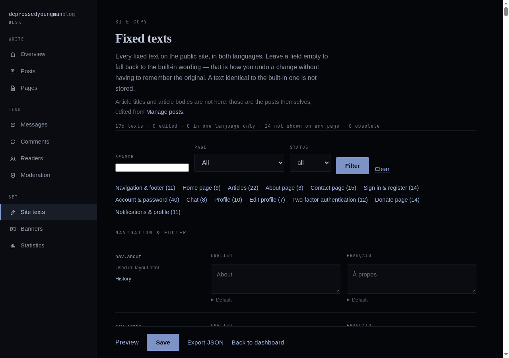

**Modération : liste de blocage, envois refusés, comptes bannis (entrées de démonstration)**

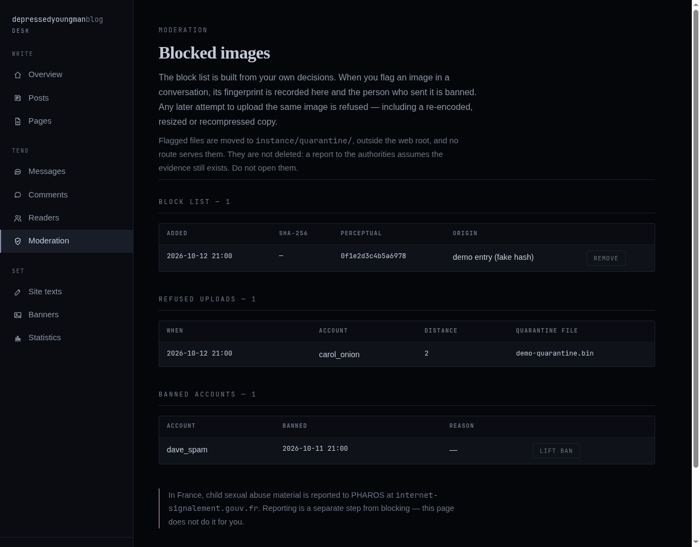

## Fonctionnalités

- **Articles** en BBCode (ou HTML simple, assaini avec `nh3`), brouillons,
  publication programmée, une révision enregistrée à chaque modification,
  catégories (`/category/<slug>`) et tags (`/tag/<slug>`), recherche
  (`/search?q=`), flux RSS (`/feed.xml`). Aide BBCode sur `/editor_help`.
- **Commentaires** : réponses imbriquées, BBCode rendu côté serveur, likes sur
  articles et commentaires, notifications.
- **Chat privé** entre chaque lecteur et les admins, avec pièces jointes ; les
  deux sont chiffrés au repos. Dans le navigateur c'est un simple formulaire ;
  la page de conversation admin se recharge seule (meta refresh avec une
  courte attente côté serveur), donc les nouveaux messages apparaissent sans
  JavaScript. Les événements Socket.IO et le flux de l'API mobile sont
  disponibles pour les clients qui les utilisent.
- **Interface bilingue** (anglais / français, `?lang=`), chaque texte fixe
  étant modifiable depuis l'administration, avec historique, retour arrière et
  export/import JSON.
- **Modération des images** : signaler une pièce jointe bannit son expéditeur,
  déplace le fichier dans `instance/quarantine/` et enregistre son SHA-256 et
  son empreinte perceptuelle ; tout nouvel envoi de la même image, même
  réencodée ou redimensionnée, est refusé.
- **Page sécurité du compte** : changement de mot de passe, activation et
  désactivation de la 2FA, codes de secours, déconnexion partout, export des
  données, suppression du compte. Les actions sensibles redemandent le mot de
  passe (et le code 2FA s'il est activé).
- **Anti-spam sans JS** à l'inscription, dans les commentaires et le contact :
  champ piège et âge minimum signé du formulaire, sans captcha.
- **Gamification** : XP, niveaux et badges attribués automatiquement.
- **Administration** : vue d'ensemble de ce qui attend, articles, pages
  statiques, bannières, utilisateurs (promouvoir, rétrograder, supprimer),
  commentaires, modération, textes du site, statistiques.
- **Formulaire de contact et page de dons.** Les messages de contact sont
  enregistrés en base (la vue d'ensemble affiche le nombre de non lus ; il n'y
  a pas de page pour les lire dans cette version). Sur la page de dons, un
  visiteur peut déclarer un montant, enregistré comme « Anonymous » ; les cinq
  plus élevés sont affichés.
- **API mobile d'administration** (HTTP Basic Auth + en-tête TOTP, flux SSE),
  désactivable.
- **Scripts d'exploitation** : mise à jour sûre avec retour arrière, mises à
  jour programmées optionnelles, sauvegardes chiffrées.

## Démarrage rapide

Nécessite Python 3 (la CI utilise 3.12).

```bash
git clone https://github.com/kerstz/blog-privacy.git
cd blog-privacy
python3 -m venv venv && source venv/bin/activate
pip install -r requirements.txt

cp .env.example .env
# Renseigner SECRET_KEY, ENCRYPTION_KEY et ENCRYPTION_SALT, une valeur chacune :
python -c "import secrets; print(secrets.token_urlsafe(48))"
# Pour le développement local en HTTP simple, ajouter aussi SESSION_COOKIE_SECURE=false

flask db upgrade              # créer / migrer la base
python create_admin.py        # première fois : créer un compte admin
python wsgi.py                # serveur de développement sur http://127.0.0.1:5000
```

L'application refuse de démarrer si un secret obligatoire manque, vaut encore
`change_me` ou est trop court (`SECRET_KEY` sous 32 caractères, les valeurs de
chiffrement sous 16). Sur une nouvelle installation, ajoutez aussi
`ENCRYPTION_ITERATIONS=600000`.

**Sauvegardez `ENCRYPTION_KEY`, `ENCRYPTION_SALT` et `ENCRYPTION_ITERATIONS`.**
Sans exactement les mêmes valeurs, messages du chat, fichiers envoyés et
secrets TOTP ne pourront plus jamais être déchiffrés.

## Configuration

Tous les réglages sont des variables d'environnement, en général lues depuis
`.env` (voir [.env.example](.env.example)).

| Variable | Défaut | Rôle |
|----------|--------|------|
| `SECRET_KEY` | aucun (obligatoire) | Secret Flask : signe sessions et jetons CSRF, sale les empreintes du rate limiter. Au moins 32 caractères. |
| `ENCRYPTION_KEY` | aucun (obligatoire) | Phrase secrète dont est dérivée la clé Fernet. Au moins 16 caractères. Ne jamais la changer sur une base existante. |
| `ENCRYPTION_SALT` | aucun (obligatoire) | Sel PBKDF2 de la clé ci-dessus. Au moins 16 caractères. Ne jamais le changer sur une base existante. |
| `ENCRYPTION_ITERATIONS` | `100000` | Itérations PBKDF2. Le défaut garde les anciennes données lisibles ; mettre `600000` sur une base neuve et vide. Le changer ensuite rend illisibles les données déjà chiffrées. |
| `DATABASE_URL` | `sqlite:///blog.db` | URI SQLAlchemy de la base (un chemin SQLite relatif est placé dans `instance/`). |
| `SESSION_COOKIE_SECURE` | `true` | N'envoyer les cookies que sur une connexion sûre. Mettre `false` en développement local en HTTP simple, sinon la connexion est impossible. |
| `SESSION_COOKIE_NAME` | `__Host-sid` (ou `sid` si non sécurisé) | Nom du cookie de session. |
| `MAX_CONTENT_LENGTH` | `12582912` (12 Mio) | Taille maximale d'un corps de requête. |
| `MAX_UPLOAD_BYTES` | `10485760` (10 Mio) | Taille maximale d'un fichier envoyé. |
| `SECURITY_STATE_DB` | `instance/security_state.db` | Fichier SQLite du rate limiter persistant (clés hachées uniquement). |
| `ONION_ADDRESS` | vide | Adresse onion v3 (`<56 caractères>.onion`). Si renseignée, les réponses hors onion portent un en-tête `Onion-Location`. Une valeur invalide empêche le démarrage. |
| `TRUSTED_PROXY_COUNT` | `0` | Nombre de reverse proxys de confiance devant l'application (active la prise en compte de `X-Forwarded-*`). Laisser `0` si l'application est exposée directement, sinon un client pourrait falsifier son adresse et contourner les limites. |
| `TRUST_PROXY` | non défini | Ancienne syntaxe : `true` vaut `TRUSTED_PROXY_COUNT=1`. |
| `FORCE_HSTS` | `false` | Envoyer HSTS même si Flask ne voit pas HTTPS (TLS terminé en amont). À ne pas utiliser pour un service onion. |
| `LOG_CLIENT_IP` | `false` | Garder les adresses IP des clients dans les journaux. Débogage uniquement. |
| `MOBILE_API_ENABLED` | `true` | `false` coupe `/api/admin/mobile/*` (toutes les routes répondent 404). |
| `TEMPLATE_AUTO_RELOAD` | `false` | Développement : recharger les gabarits sans redémarrer. |
| `HOST` / `PORT` | `127.0.0.1` / `5000` | Adresse du serveur de développement lancé par `python wsgi.py`. |
| `FLASK_DEBUG` | `false` | Mode debug du serveur de développement. Jamais sur une machine joignable : le débogueur Werkzeug permet d'exécuter du code. |

Lues par les scripts, dans le même `.env` :

| Variable | Défaut | Utilisée par | Rôle |
|----------|--------|--------------|------|
| `UPDATE_RESTART_CMD` | vide | `update.sh`, `auto-update.sh` | Commande lancée après une mise à jour réussie, par ex. `sudo systemctl restart blog`. |
| `BACKUP_PASSPHRASE` | aucun (obligatoire pour les sauvegardes) | `backup.sh` | Phrase de chiffrement des sauvegardes, au moins 16 caractères. En garder une copie hors du serveur. |
| `BACKUP_KEEP` | `14` | `backup.sh` | Nombre de sauvegardes locales conservées. |
| `BACKUP_REMOTE` | vide | `backup.sh` | Cible `rsync` optionnelle (`user@host:/chemin/`) pour une copie externe. |

L'ancien pont Telegram a été retiré ; les variables `TELEGRAM_*` sont ignorées.

## Déploiement

Le serveur de développement (`python wsgi.py`) n'est pas fait pour la
production. En production, l'application tourne sous gunicorn, liée à
`127.0.0.1`, derrière un reverse proxy et/ou Tor.

### En service onion Tor (scripté)

Pour Debian/Ubuntu, `deploy/deploy-onion.sh` installe ce qui manque (Python,
Tor, ufw, fail2ban, unattended-upgrades), crée un utilisateur système dédié,
génère les secrets, configure le service onion et une unité systemd durcie qui
n'écoute que sur `127.0.0.1`, ferme le trafic entrant dans le pare-feu, crée un
compte admin avec un mot de passe aléatoire, et lance des vérifications de
fuite à la fin.

```bash
bash deploy/package.sh                        # archive propre du code seul
bash deploy/package.sh 192.168.1.42           # ... et affiche les commandes scp
# puis, sur le serveur :
sudo bash deploy/deploy-onion.sh --dry-run    # affiche chaque action, ne change rien
sudo bash deploy/deploy-onion.sh
sudo bash deploy/harden-tor.sh --status       # optionnel : ponts obfs4, vanguards
```

Détails, liste des vérifications et ce que le script ne fait pas (chiffrement
du disque et du swap, sauvegarde de la clé onion) : [deploy/README.md](deploy/README.md).

### Installation classique (HTTPS, miroir onion optionnel)

Fichiers prêts à adapter dans `deploy/` :

| Fichier | Rôle |
|---------|------|
| `blog.service` | unité systemd : utilisateur dédié sans privilèges, sandbox, `gunicorn --workers 1 --threads 32` sur `127.0.0.1:8000` |
| `Caddyfile` | reverse proxy avec HTTPS automatique et journaux d'accès supprimés, plus une entrée locale `127.0.0.1:8080` pour Tor |
| `nginx.conf` | reverse proxy alternatif (certificats certbot, `access_log off`, location WebSocket) |
| `torrc.example` | service onion pointant vers le reverse proxy sur `127.0.0.1:8080` ; mettre le nom d'hôte généré dans `ONION_ADDRESS` |

`.env` de production : garder `SESSION_COOKIE_SECURE=true`, mettre
`TRUSTED_PROXY_COUNT=1` derrière le reverse proxy, `ENCRYPTION_ITERATIONS=600000`
sur une nouvelle installation, et activer la 2FA sur tous les comptes admin.
Garder un seul worker gunicorn : les flux SSE et les salons Socket.IO vivent
dans le processus.

## Mises à jour et sauvegardes

```bash
./update.sh                          # mettre à jour maintenant (interactif)
./auto-update.sh enable weekly       # daily | weekly | monthly | "<expression cron>"
./auto-update.sh status
./auto-update.sh disable
./backup.sh run                      # sauvegarde chiffrée : bases + uploads + .env
./backup.sh enable daily             # daily | weekly | "<expression cron>"
./backup.sh restore <fichier> <dossier>   # déchiffre dans un NOUVEAU dossier vide
```

`update.sh` :

1. sauvegarde `instance/`, `uploads/` et les `*.db` dans `backups/` ;
2. récupère le code avec `git pull --ff-only` (abandonne s'il y a des
   modifications locales du code) ;
3. met à jour les dépendances depuis `requirements.txt` ;
4. lance `flask db upgrade` ;
5. vérifie que l'application s'importe, et lance les tests si pytest est
   installé ;
6. chiffre les anciens messages et fichiers encore en clair
   (`flask encrypt-legacy`) ;
7. analyse les dépendances avec `pip-audit` ;
8. redémarre l'application avec `UPDATE_RESTART_CMD` s'il est défini.

Si les étapes 2 à 5 échouent, code et dépendances reviennent en arrière. Il ne
modifie jamais `.env` et ne supprime aucune donnée. Les mises à jour
automatiques sont désactivées tant que vous ne les activez pas ; elles lancent
`./update.sh --auto` via cron, ne font rien s'il n'y a pas de nouveau commit,
et écrivent dans `logs/update.log`.

`backup.sh` chiffre avec gpg (AES-256) s'il est disponible, sinon avec openssl
AES-256-CBC et PBKDF2. Une restauration n'écrase jamais les données en service.

## API mobile d'administration

| Méthode et chemin | Rôle |
|-------------------|------|
| `GET /api/admin/mobile/ping` | tester l'authentification admin |
| `GET /api/admin/mobile/conversations` | utilisateurs et dernier message par conversation |
| `GET /api/admin/mobile/conversations/<user_id>/messages?limit=50` | historique d'une conversation |
| `POST /api/admin/mobile/conversations/<user_id>/messages` | répondre à un utilisateur |
| `GET /api/admin/mobile/stream` | flux d'événements en temps réel (Server-Sent Events) |

Authentification HTTP Basic avec un compte admin. Si le compte a la 2FA, le
code du moment doit être envoyé dans l'en-tête `X-TOTP-Code` (sinon 401). Les
échecs répétés verrouillent le pseudo et le client pendant 15 minutes (429).
`MOBILE_API_ENABLED=false` la coupe entièrement (404). À n'utiliser qu'en HTTPS
ou via le service onion.

```bash
curl -u admin:votre_mot_de_passe -H "X-TOTP-Code: 123456" \
  https://blog.example.org/api/admin/mobile/conversations
```

## Notes de sécurité

- CSP stricte, `X-Frame-Options: DENY`, `X-Content-Type-Options: nosniff`,
  `Referrer-Policy: no-referrer`, `Permissions-Policy` restrictive, en-têtes
  d'isolation cross-origin, en-tête `Server` générique.
- HSTS est envoyé en HTTPS, quand `SESSION_COOKIE_SECURE` est actif, ou avec
  `FORCE_HSTS=true`.
- Jetons CSRF sur tous les formulaires, déconnexion comprise ; ils expirent
  après 4 heures.
- Le HTML des utilisateurs est échappé ou assaini ; les fichiers envoyés sont
  contrôlés (SVG, HTML et XML refusés), limités en taille et en pixels, et
  servis uniquement aux utilisateurs autorisés.
- Les pages des utilisateurs connectés sont envoyées avec
  `Cache-Control: no-store`.
- Les événements de sécurité (connexions admin, échecs sur un compte admin,
  changements de 2FA, changements de rôle, suppressions) sont écrits dans le
  journal de l'application uniquement.

Voir [SECURITY.fr.md](SECURITY.fr.md) pour l'historique de sécurité. **Pour
signaler une vulnérabilité, ouvrez un avis de sécurité privé sur GitHub**
(onglet Security du dépôt) plutôt qu'une issue publique.

## Tests et CI

```bash
pip install -r requirements-dev.txt
pytest tests                          # tests de non-régression de sécurité
pip-audit -r requirements.txt         # CVE connues dans les dépendances
bandit -r app create_admin.py wsgi.py -q
```

Les tests créent leur propre base et leurs propres secrets jetables ; aucun
`.env` n'est nécessaire. GitHub Actions
([.github/workflows/security.yml](.github/workflows/security.yml)) tourne à
chaque push sur `main`, à chaque pull request et chaque lundi :

- `pytest -q tests/` sous Python 3.12 ;
- `pip-audit` sur `requirements.txt` ;
- analyse statique `bandit` ;
- une vérification des gabarits qui échoue sur `<script>`, `<style>`, les
  gestionnaires d'événements inline, les URL `javascript:`, ou un `src`/`href`
  externe sans `rel="noreferrer"`.

Dependabot ouvre des pull requests groupées pour les dépendances Python
(chaque semaine) et les GitHub Actions (chaque mois).

## Organisation du projet

```
app/
  __init__.py      création de l'app, configuration, extensions, filtres de gabarits
  routes.py        routes web, en-têtes de sécurité, handlers SocketIO, modération, textes du site
  services.py      fonctions partagées : auth, TOTP, fichiers, chat, export, suppression
  mobile_api.py    API REST mobile d'administration + SSE
  cli.py           commande de maintenance (flask encrypt-legacy)
  models.py        modèles de base de données
  forms.py         classes WTForms (anti-spam, validateurs)
  site_text.py     textes bilingues, modifiables par l'admin
  image_safety.py  empreintes perceptuelles, liste de blocage, quarantaine
  encryption.py    chiffrement Fernet au repos
  utils.py         BBCode, assainissement, traitement des images, rôles, rate limiter persistant
  static/css/      style.css (thème Small Hours), icons.css, admin.css, pages/*.css
  templates/       gabarits Jinja2 (sans JavaScript, sans <style>)
migrations/        migrations Alembic (flask db upgrade)
tests/             tests de non-régression de sécurité
deploy/            script de déploiement onion, durcissement Tor, systemd, Caddy, nginx, torrc
docs/              ANONYMAT.md (audit de confidentialité), screenshots/
archive/telegram/  ancien pont Telegram, conservé en lecture seule
tools/             générateur du sprite d'icônes
create_admin.py    création interactive d'un admin
wsgi.py            point d'entrée WSGI (gunicorn wsgi:application)
update.sh  auto-update.sh  backup.sh
```

## Licence

MIT, voir [LICENSE](LICENSE).
